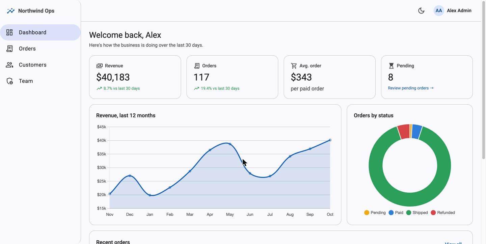
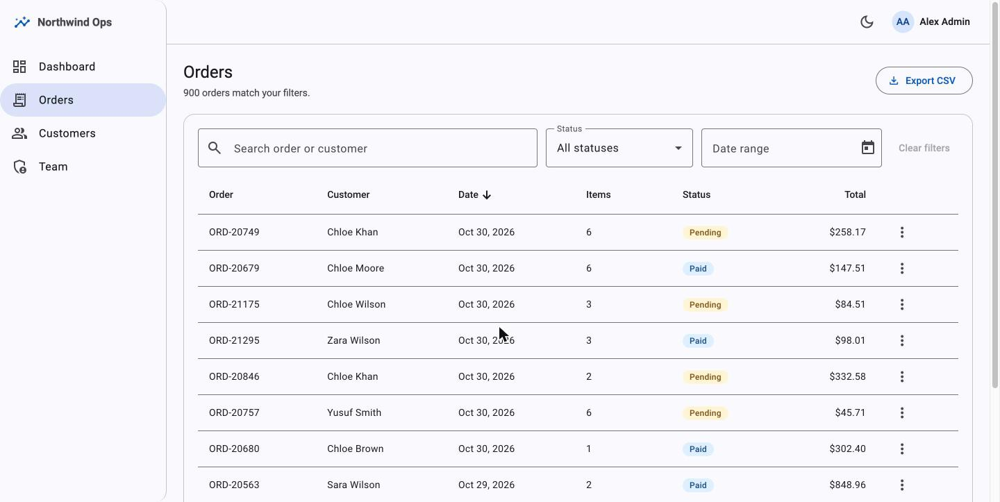
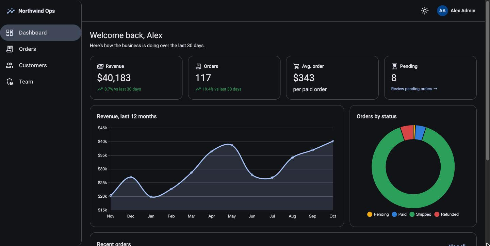
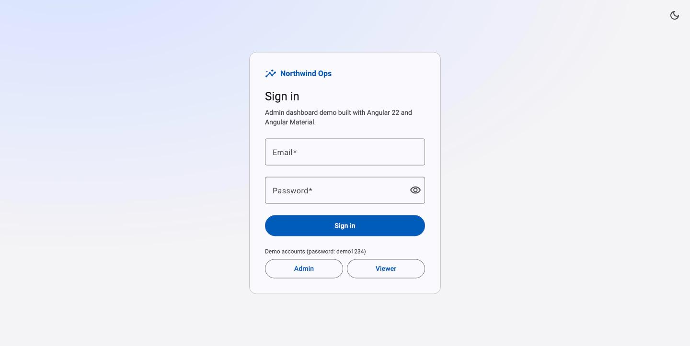

# Northwind Ops: Angular Admin Dashboard

A production-style admin dashboard built with **Angular 22**, **Angular Material 3**, and **Chart.js**. It shows the patterns I use on real client projects: role-based auth, data tables with server-style filtering, charts, a responsive layout, dark mode, and unit tests.

**Live demo:** _coming soon_ · sign in with `admin@northwind.dev` / `demo1234` (or `viewer@northwind.dev` to see the read-only role)



## Features

- **Auth & roles**: login form with validation, session persistence, `authGuard` with return URL, and a `roleGuard` that keeps viewers out of admin pages
- **Dashboard**: KPI cards with period-over-period change, 12-month revenue line chart, orders-by-status doughnut, recent orders
- **Orders table**: search, status filter, date-range picker, sorting, pagination, CSV export, deep links (`/orders?status=pending`), and admin-only status changes
- **Customers table**: search plus plan filter, sortable columns
- **Dark mode**: one toggle, saved per browser, no flash on reload; charts restyle from Material 3 tokens
- **Responsive**: side navigation on desktop, slide-over menu on phones and tablets
- **Accessible**: labelled controls, keyboard-friendly Material components, ARIA labels on charts and icon buttons

| Orders | Dark mode | Sign in |
|---|---|---|
|  |  |  |

## Tech

| | |
|---|---|
| Framework | Angular 22 (standalone components, signals, zoneless change detection, lazy-loaded routes) |
| UI | Angular Material 3 + CDK |
| Charts | Chart.js 4 (tree-shaken, only the controllers in use are registered) |
| State | Angular signals; RxJS for async data flows (`debounceTime` → `switchMap`) |
| Tests | Vitest via `ng test` |
| Deploy | Vercel (SPA rewrites in `vercel.json`) |

## Project structure

```
src/app/
├── core/            # models, data service (mock API), auth service + guards, theme service
├── layout/shell.ts  # sidenav + toolbar, responsive breakpoints
├── shared/chart.ts  # Chart.js wrapper that re-renders on theme change
└── features/        # login, dashboard, orders, customers, team (lazy-loaded)
```

`DataService` is the only place that knows the data is mocked. Its methods return Observables with simulated latency, so connecting a real REST API means changing that one file to use `HttpClient`.

## Run it locally

```bash
npm install
npm start          # http://localhost:4200
npm test           # unit tests (22 specs)
npm run build      # production build in dist/
```

## Tests

Unit tests cover the order filter logic (status, search, date range), the deterministic mock data generator, `DataService` updates and aggregations, `AuthService` sign in/out, both route guards, and the chart color helper.

---

Built by **Ahmed Magdy**, a senior Angular developer who works on Angular upgrades, AngularJS migrations, and enterprise dashboards. [GitHub](https://github.com/AhmedMagdyy1)
